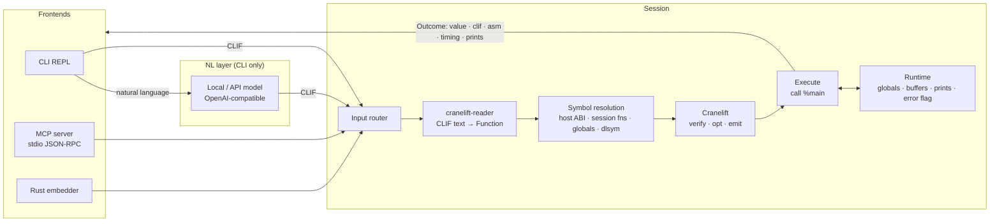
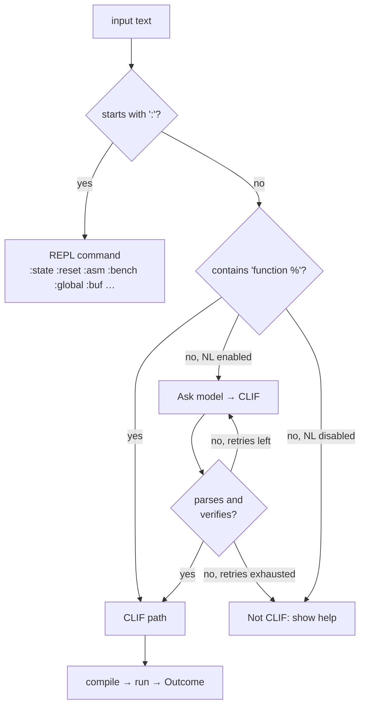
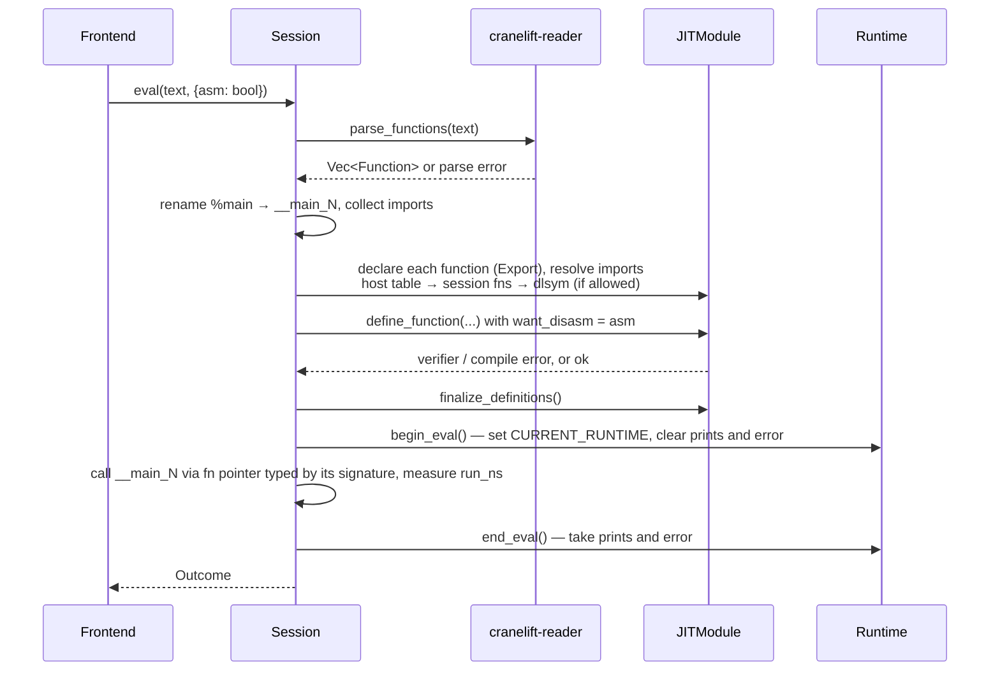
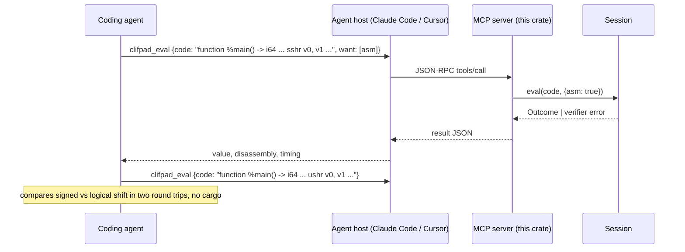

# Native Scratchpad — design spec

Status: v2, 2026-09-12, implemented through M4 (see §9). Supersedes the MiniLang POC. v2 drops MiniLang: Cranelift IR (CLIF) is the only language.

## 1. What this is

A **native scratchpad**: small programs written in textual Cranelift IR are compiled and run in-process within milliseconds, and every run reports what happened at the machine level (value, optimized IR, disassembly, timing). It is used three ways:

| Frontend | User | Input |
|---|---|---|
| Library (`Session`) | Rust programs embedding it | CLIF text |
| CLI REPL | A developer at a prompt | CLIF text or natural language |
| MCP server | A coding agent (Claude Code, Cursor, …) | CLIF text |

This is the original idea taken literally: the model or agent writes JIT IR directly, and there is no compile, link, or launch step. The natural-language layer in the CLI is a model that writes CLIF on the user's behalf. When an agent is the caller, the agent is the model and writes CLIF itself.

### 1.1 Why native, when a Python snippet is also instant

Native wins when the question is about what the machine actually does:

- Bit-exact integer semantics: wrapping, shifts, sign, overflow.
- Float behavior: NaN propagation, rounding, fused multiply-add.
- Calling a C ABI symbol already loaded in the process, with no C compiler and no bindings.
- Microbenchmarks with real timings, no `cargo bench`, no link step.
- Codegen inspection: "what does this loop compile to?" with IR and disassembly side by side.

Today a coding agent answers these by writing a Rust file and waiting for cargo. This answers in milliseconds.

### 1.2 Why CLIF only, no surface language

The POC's MiniLang existed because a model writing raw IR was assumed to be too error-prone. That assumption is the thing to test, not design around. Going CLIF-only:

- Removes the parser, type checker, and lowering (roughly 2000 lines) and replaces them with `cranelift-reader`.
- Makes the Cranelift verifier the type checker. Its errors are precise and are the retry signal for the model.
- Gets to the hypothesis fastest: can a local model write valid CLIF for real tasks? Milestone 2 measures this.

What it costs: CLIF is verbose SSA with explicit blocks and no bounds checking. Humans will not type it for `2 + 3`, and small models may fail often. If M2 shows the failure rate is too high, a thin frontend can be added then, sized to exactly the gaps observed. Not before.

### 1.3 Non-goals

- Not a scripting language. No strings, maps, closures, or I/O beyond `print`.
- Not a sandbox. CLIF has raw loads and stores. A bad address segfaults the process. See §8.
- Not a Rust or C compiler.

## 2. Architecture



Every evaluation produces an `Outcome`, whichever frontend asked:

```rust
pub struct Outcome {
    pub value: Option<Scalar>,    // I64(i64) | F64(f64) | Unit, from %main's signature
    pub prints: Vec<String>,
    pub clif: String,             // IR after Cranelift optimization
    pub asm: Option<String>,      // native disassembly, on request
    pub compile_ns: u64,
    pub run_ns: u64,
    pub code_bytes: usize,
    pub defined: Vec<String>,     // functions this eval added or replaced
}
```

## 3. Input routing



The MCP server and the library never call the model. Model output goes through the same reader and verifier as human input, and those errors are the retry feedback (max 2 retries).

## 4. CLIF conventions

Everything below is plain CLIF as `cranelift-reader` parses it. The session adds only naming conventions and a symbol table.

### 4.1 Entry point

The text may contain any number of functions. `%main` is the entry, with one of these signatures:

```clif
function %main() -> i64
function %main() -> f64
function %main()
```

Its return value, typed by the signature, is the `Outcome.value`. Text with no `%main` only defines functions.

Calling conventions in the text are ignored: the session rewrites every function signature and every `sig` declaration to the host ISA's default convention (`apple_aarch64` on this machine, `system_v` on Linux). The reader defaults to `fast` when the convention is omitted, which happens to work for simple signatures and would silently break for others, so the rewrite is unconditional. The prompt and tool description tell the model to omit the convention.

### 4.2 Calling other functions

Standard CLIF import syntax. The session resolves names in this order:

1. `%rt_*`: the host ABI (§4.3).
2. A function defined by an earlier evaluation in this session.
3. With `--allow-unsafe`, any symbol `dlsym` can find in the process (`%strlen`, `%malloc`, …).

```clif
function %dot(i64, i64, i64) -> f64 {
    ; a: ptr, b: ptr, n: len
block0(v0: i64, v1: i64, v2: i64):
    v3 = f64const 0.0
    v4 = iconst.i64 0
    jump block1(v4, v3)

block1(v5: i64, v6: f64):
    v7 = icmp slt v5, v2
    brif v7, block2, block3

block2:
    v8 = iconst.i64 3
    v9 = ishl v5, v8
    v10 = iadd v0, v9
    v11 = iadd v1, v9
    v12 = load.f64 v10
    v13 = load.f64 v11
    v14 = fma v12, v13, v6
    v15 = iconst.i64 1
    v16 = iadd v5, v15
    jump block1(v16, v14)

block3:
    return v6
}

function %main() -> f64 {
    sig0 = (i64, i64, i64) -> f64
    fn0 = %dot sig0
    gv0 = symbol %xs
    gv1 = symbol %ys
block0:
    v0 = symbol_value.i64 gv0
    v1 = symbol_value.i64 gv1
    v2 = iconst.i64 1024
    v3 = call fn0(v0, v1, v2)
    return v3
}
```

A later evaluation can call `%dot` by declaring the import again; the body persists.

Float literals: `cranelift-reader` accepts only hexadecimal float literals (`0x1.8p1`), plus `0.0`, `Inf` and `NaN`. A model cannot be expected to convert `0.1` to `0x1.999999999999ap-4`, so the session rewrites decimal literals after `f64const` / `f32const` to hex before parsing (verified, §11). The prompt tells the model to write decimals.

Note for the prompt and the tool description: Cranelift 0.135 has no immediate-form instructions. `iadd_imm`, `ishl_imm`, `sshr_imm`, `icmp_imm` and the rest were removed upstream, and models trained on older CLIF emit them constantly. Constants go through `iconst` first, as above. The examples in this document parse and verify against 0.135.

### 4.3 Host ABI

Small and fixed. Every function is `extern "C"`, so it uses the host's default C convention, which is what §4.1's rewrite applies to every import signature.

| Symbol | Signature | Purpose |
|---|---|---|
| `%rt_print_i64` | `(i64)` | Append to `Outcome.prints` |
| `%rt_print_f64` | `(f64)` | |
| `%rt_print_str` | `(i64, i64)` ptr, len | Print UTF-8 bytes |
| `%rt_now_ns` | `() -> i64` | Monotonic clock |
| `%rt_alloc` | `(i64) -> i64` bytes → ptr | Zeroed session-owned memory, freed on `:reset` |
| `%rt_fail` | `(i64)` code | Set the error flag; `Outcome` becomes an error |

Host functions that touch the runtime read a thread-local `CURRENT_RUNTIME` set around the call to `%main`. Evaluation is single-threaded.

### 4.4 Globals and buffers

Session-owned memory is created by command or tool, then referenced from CLIF as a symbol whose value is its address:

```
:global counter i64          → %counter is the address of an 8-byte slot
:buf xs f64 1024             → %xs is the address of 8192 zeroed bytes
:buf name u8 "hello"         → %name is the address of the bytes, %name_len is a slot holding 5
```

Addresses are stable for the session (each allocation is its own `Box`). Code reads and writes them with ordinary `load` and `store`. Buffer lengths are the caller's responsibility, exactly as in C. The `:state` command and `clifpad_state` tool list every symbol with its type, length, and a preview of its contents.

A symbol name is bound once per session. `JITModule` caches the address the first time a symbol is resolved, so re-creating `%xs` at a new address would leave every later evaluation reading the old one (verified in the spike, §11). Therefore there is no `del`: a name can be re-declared only with the same type and length, which is a no-op, and memory is released only by `:reset`, which also rebuilds the `JITModule`.

### 4.5 Persistence and redefinition

- Functions persist across evaluations. Re-defining `%name` declares a new function under the same symbol; future evaluations get the new body, code compiled earlier keeps the old pointer. This is how a `JITModule` works and is documented rather than hidden.
- Globals and buffers persist until `:reset`.
- `%main` is re-declared on every evaluation under an internal unique name (`__main_N`), so `%main` is never callable from other code.

## 5. Compilation and execution



Details that matter:

- **Verifier runs explicitly.** The session calls `verify_function` before `define_function` and formats failures with `pretty_verifier_error`, which annotates the offending instruction inline. The error that `define_function` itself returns says only "Verifier errors" and is useless as feedback (verified, §11).
- **Symbol resolution is a pre-check.** `JITModule` falls back to `dlsym` for any unknown symbol by default, so the `--allow-unsafe` gate is enforced by the session refusing to declare an import it cannot account for, before anything is compiled.
- **Optimized CLIF** is what `Outcome.clif` shows: `ctx.func` after `define_function`, not the input text.
- **Disassembly** comes from `Context::want_disasm`, no extra dependency.
- **Timing** is wall-clock around the call. `:bench N` repeats the call and reports min, median, and max. Compile time is reported separately so it is never mistaken for run time.
- **Errors at run time** exist only if the code calls `%rt_fail`. Cranelift traps (`trapz`, `udiv` by zero) raise a signal. The session installs no handler; see §8.

## 6. Natural-language layer (CLI only)

The model is an OpenAI-compatible endpoint, defaulting to a local Ollama server. The prompt contains:

1. A CLIF cheat sheet: types, the instructions that matter (`iconst`, `iadd`, `icmp`, `brif`, `jump` with block args, `load`/`store`, `call`, float ops), the entry convention, the host ABI table, and an explicit "no `*_imm` instructions" rule with the `iconst` pattern.
2. Three or four worked examples, including one loop, chosen from the M2 task set.
3. Current session symbols: functions with signatures, globals and buffers with types and lengths.
4. The last N turns (input, CLIF, result or error).
5. On retry, the verifier's error text.

The model emits CLIF only. Fenced blocks are stripped. The POC's offline pattern translator is removed; without a model configured, the CLI is a plain CLIF REPL.

## 7. MCP server

JSON-RPC over stdio, one `Session` per process. Tools:

| Tool | Input | Output |
|---|---|---|
| `clifpad_eval` | `code`, `want: [clif, asm]` | `Outcome` as JSON, or `{error}` |
| `clifpad_bench` | `code`, `iterations` | `min_ns median_ns max_ns` plus `Outcome` of one run |
| `clifpad_alloc` | `name`, `type: i64\|f64\|u8`, `len` or `bytes` | address as decimal, for reference |
| `clifpad_state` | — | functions with signatures, symbols with types, lengths, previews |
| `clifpad_reset` | — | ok |



The tool description carries the §4 conventions and the cheat sheet from §6 so the agent needs no separate documentation.

## 8. Safety model

- **Memory.** CLIF has raw loads and stores. A wild address segfaults the process. There is no bounds checking and no attempt at one. The MCP server is one process per session, so a crash or hang kills only that server, and the host's tool timeout reports it. The CLI documents this and offers `:save` / `:load` of the session's function text so a crash is recoverable.
- **Traps.** `trapz`, `trapnz`, and trapping division raise `SIGILL` or `SIGFPE`. Same consequence as a segfault. A signal handler that converts these into an `Outcome` error is possible but not in scope until someone needs it.
- **FFI.** Resolving arbitrary process symbols via `dlsym` is gated by `--allow-unsafe`. Without the flag, only `%rt_*` and session functions resolve.
- **Hangs.** JIT code cannot be preempted safely. Same mitigation as crashes: process isolation, plus a timeout. One of 22 model-written programs in §11.1 looped forever, so this is required in every frontend, not only MCP.
- **Crash messages.** The exit signal is diagnostic and is reported as such: `SIGILL` is a Cranelift trap (division by zero or explicit trap), `SIGSEGV` / `SIGBUS` is a bad address, a timeout is a non-terminating loop. Each gets a distinct message with the likely cause, because that message is the model's only retry signal.
- **Resource caps.** `%rt_alloc` and `clifpad_alloc` refuse a single allocation over a configurable limit (default 256 MiB) and a session total over 1 GiB.

## 9. Milestones

Each milestone is shippable on its own and has a test that proves it.

**M1 — CLIF session.** Done. `src/session.rs` and `src/runtime.rs` implement §4 and §5; `tests/e2e.rs` holds 20 acceptance tests including the 1M-element dot product (measured 0.8 to 0.95 ms, bar is 2 ms), verifier error text, persistence, redefinition, the dlsym gate, allocation limits, and reset.

**M2 — model experiment.** Done for Qwen3.8-Flash, see §11.1: 19 of 22 tasks correct on the first try, 20 of 22 within two retries. The task set in `prompts/tasks.json` is the regression suite for the prompt; rerun it whenever the cheat sheet or the host ABI changes, and against Deepseek when available. Remaining M2 work: wire `prompts/experiment.py` to the real binary once M1 lands.

**M3 — MCP server.** Done. `src/mcp.rs` serves the five tools over newline-delimited JSON-RPC; `scripts/mcp_smoke.py` exercises the handshake, every tool, the verifier error path, and clean EOF exit. The Claude Code acceptance check (answering the shift question through `clifpad_eval`) is still to be run by hand: `claude mcp add clifpad -- target/release/clifpad --mcp`.

**M4 — NL layer in the CLI.** Done in code: `src/nl.rs` and the REPL in `src/main.rs` implement the prompt, six-message history, and the retry loop with a temperature ramp; `:save` / `:load` exist. Verified against stub servers for prompt shape, retries, exhaustion, and network failure. Not yet verified against the real local model from the CLI, because the model server was unreachable when the frontends were merged; `prompts/experiment.py` now drives the real binary and is the way to do that.

**M5 — polish.** Remaining: a hang timeout in the CLI (§8 requires it in every frontend; today only MCP has process isolation, via the host), a signal handler or forked worker so a trap does not kill the REPL, crate rename. Done already: `dlsym` behind `--allow-unsafe`, resource caps, README rewrite.

## 10. Crate layout after M1

```
src/
  lib.rs        pub use session::{Session, Outcome, EvalOptions, Scalar}
  session.rs    eval loop, symbol table, timing, bench, Outcome
  runtime.rs    globals, buffers, host ABI (extern "C" fns), CURRENT_RUNTIME
  nl.rs         model client and prompt (CLI only)
  mcp.rs        stdio JSON-RPC server
  main.rs       CLI: REPL, --eval, --mcp
tests/
  e2e.rs        per-milestone acceptance tests
scripts/
  mcp_smoke.py  end-to-end check of the MCP server over stdio
prompts/
  cheatsheet.md CLIF reference shared by the NL prompt and the MCP tool description
  tasks.json    the M2 task set with expected results
  experiment.py harness: model → CLI --eval → score, with error-only retries
  results/      run logs
```

Kept from the POC: the REPL shell and command dispatch in `main.rs`, the Cranelift module and host-symbol registration pattern in `jit.rs`, the model client in `ai.rs`. `lang.rs`, `compile.rs`, `value.rs`, and `state.rs` are deleted.

Dependencies added: `cranelift-reader`. Removed: none. Cranelift stays at one pinned version across `cranelift`, `cranelift-jit`, `cranelift-module`, `cranelift-native`, `cranelift-reader`.

## 11. Verified assumptions

A throwaway spike (cranelift 0.135, Apple M-series, debug build of the harness, `opt_level=speed` for JIT code) exercised every Cranelift-facing claim in this document on 2026-09-12.

| Claim | Result |
|---|---|
| `cranelift-reader` text → `JITModule` → callable pointer | Works. Imports are `ExternalName::TestCase` after parsing and must be rewritten to `User` names with the module's function or data id, or relocation panics. |
| Session functions persist and are callable from later text | Works. Redefinition declares a fresh internal name; an earlier caller keeps the old body, a new caller gets the new one, exactly as §4.5 states. |
| Globals as symbols via `symbol_lookup_fn` | Works. Address is cached after first resolution, hence the no-`del` rule in §4.4. |
| `%dot` over two 1M-element `f64` buffers | 850 µs per run, under the 2 ms acceptance bar. First compile of both functions 1.8 ms; recompiling only `%main` 300 µs. |
| `want_disasm` produces disassembly | Yes, real aarch64 mnemonics. `ctx.func` after `define_function` is the optimized IR: `6 * 7` displays as `iconst.i64 42`. |
| `system_v` in the text on macOS arm64 | Compiles and runs for simple signatures, but the ISA default is `apple_aarch64`. Rewritten unconditionally, §4.1. |
| Host functions through a thread-local | Works. |
| `--allow-unsafe` gate | Without it, `%strlen` is rejected by the pre-check. With it, `dlsym` resolves it and returns 5 for `"hello"`. |
| Verifier error quality | `pretty_verifier_error` gives the instruction, a caret, and "mismatched argument count for jump block1: got 0, expected 1". Parse errors carry a line number. |
| `trapz` kills the process | Yes, exit status 132 (`SIGILL`). |
| Decimal float literals | Rejected by the reader ("Float must be hexadecimal"). A line-level rewrite to `Ieee64::with_float(v).to_string()` fixes it. `1e3` also works after the rewrite. |

### 11.1 Model experiment (M2, first pass)

Model: Qwen3.8-Flash-Next, 4-bit MLX, served locally over the OpenAI-compatible API, temperature 0.1, no reasoning tokens used. Prompt: `prompts/cheatsheet.md`. Tasks: `prompts/tasks.json`, 22 tasks covering constants, bit ops, shifts, wrapping, loops, floats, buffers, byte scanning, printing, function definition, recursion, and a global store. Harness: `prompts/experiment.py`. Retries feed back only the parse, verifier, or crash message, never the expected value, because in real use nobody knows the expected value. Raw logs are in `prompts/results/`.

| | Cheat sheet v1 | Cheat sheet v2 |
|---|---|---|
| Valid and correct on first try | 19 / 22 | 19 / 22 |
| Valid and correct within 2 retries | 19 / 22 | 20 / 22 |
| Median latency per task | 1.5 s | 1.5 s |
| Completion tokens, whole run | 3.6 k | 4.6 k |

What failed, and why it matters for the design:

- **Syntax errors were rare and specific.** One `fcmp neq`, one missing `block0:` header, one `call %gcd(...)` without a declared `fn0`. Each produces a precise parse error. The v2 cheat sheet covers all three.
- **Semantic errors dominate.** Comparing an address instead of the loaded value, shifting a constant by the address instead of the index by 3, accumulating into a `block0` constant instead of a loop-carried block argument, and a recursion base case of `b == a` instead of `b == 0`. These are ordinary small-model logic bugs. CLIF has no safety net for them: they surface as a wrong answer, a segfault, a division trap, or an infinite loop.
- **Retries rarely help this model.** In four of five retry chains it returned byte-identical code, even with the temperature raised per attempt. The one success came from a concrete "bad memory address" message. The prompt matters far more than the retry loop.
- **Crash diagnosis matters.** `SIGILL` means a Cranelift trap (division by zero or an explicit trap), `SIGSEGV` / `SIGBUS` mean a bad address, and a hang means a loop that never terminates. The harness maps these to distinct messages, and the session must do the same.

Conclusion: the CLIF-only design holds for this model class. A 90 percent first-try rate on a mixed task set with 1 to 3 second latency is usable, and the failures are logic errors that a surface language would not have prevented. The NL layer ships as designed. Process isolation with a timeout is required, not optional, since one task in 22 hung.

## 12. Open questions

1. **Name.** Settled: `clifpad`, a pad for CLIF. Crate, binary, env prefix `CLIFPAD_`, MCP tool prefix `clifpad_`.
2. **If M2 fails for local models.** Options, in order of preference: more examples in the prompt; a larger local model; a thin frontend covering only the constructs that failed. The last option is MiniLang returning by the back door, so it needs the M2 data to justify it.
3. **WebAssembly text as an alternative input.** Models have seen far more WAT than CLIF, and wasmtime lowers it through Cranelift. It would replace `cranelift-reader` with wasmtime, a much larger dependency, and hide the IR the user came to see. Not pursued, noted in case M2 goes badly.
4. **Signal handler for traps.** Converting `SIGSEGV` / `SIGILL` / `SIGFPE` into an `Outcome` error would make the CLI far more forgiving. Deferred until process isolation proves insufficient.
